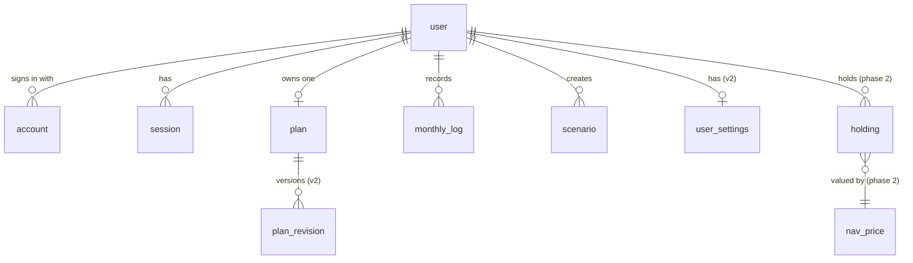

# Data model

PostgreSQL, managed with Drizzle (`lib/db/schema.ts`). Migrations are SQL files in `drizzle/`, generated by drizzle-kit and committed.

What's inside the plan document is defined in the [plan model](../03-domain/plan-model.md). This page covers the tables.

## Entity relationships

## Tables

### Auth.js tables (unchanged)

`user`, `account`, `session` and `verificationToken` have the shapes `@auth/drizzle-adapter` requires. `user` holds name, email and image from Google. Every other table references `user.id` with `ON DELETE CASCADE`, so deleting a user deletes everything they own (`ACC-5`).

### `plan`

One row per user: the current plan.

| Column | Type | Notes |
| --- | --- | --- |
| `id` | uuid PK | |
| `userId` | text, unique, FK → user | One plan per user |
| `data` | jsonb | The plan document, validated by Zod on every read and write |
| `version` **v2** | integer, default 1 | Bumped on every save; used for optimistic concurrency (`PLN-10`) |
| `baselineRevisionId` **v2** | uuid, FK → plan_revision, nullable | The revision Track compares against ([ADR-0007](decisions/0007-plan-revisions-and-frozen-baseline.md)) |
| `createdAt`, `updatedAt` | timestamp | |

### `plan_revision` v2

Append-only history of every saved plan (`PLN-11`).

| Column | Type | Notes |
| --- | --- | --- |
| `id` | uuid PK | |
| `planId` | uuid, FK → plan, cascade | |
| `userId` | text, FK → user, cascade | Kept here too, so every query can filter by user directly |
| `version` | integer | Equals `plan.version` after this save. Unique with `planId` |
| `data` | jsonb | The full plan document as saved |
| `reason` | text | `edit`, `salary-change`, `restore`, `apply-scenario`, `migration` |
| `createdAt` | timestamp | |

Index: `(userId, createdAt DESC)`. A plan document is under 20 KB, so a revision for every save for ten years is a few MB. No pruning is needed.

### `monthly_log`

One row per user and month.

| Column | Type | Notes |
| --- | --- | --- |
| `id` | uuid PK | |
| `userId` | text, FK → user | |
| `month` | text `YYYY-MM` | Unique with `userId` |
| `data` | jsonb | The balance log, validated by Zod |
| `updatedAt` | timestamp | |

### `scenario`

| Column | Type | Notes |
| --- | --- | --- |
| `id` | uuid PK | |
| `userId` | text, FK → user | |
| `name` | text | |
| `levers` **v2** | jsonb | Array of levers ([plan model](../03-domain/plan-model.md#scenario-levers-v2)) |
| `data` **v1, to drop** | jsonb | A full plan copy. Removed after migration |
| `createdAt`, `updatedAt` | timestamp | |

**Migrating v1 scenarios:** a one-off script compares each scenario's `data` with the current plan on the five lever fields (salary changes, raise %, house price, house date, house share) and writes the matching levers. Any scenario whose differences don't map to levers is listed, so the user can recreate it. Then `data` is dropped.

### `user_settings` v2

| Column | Type | Notes |
| --- | --- | --- |
| `userId` | text PK, FK → user | |
| `timezone` | text, default `Asia/Kolkata` | IANA name (`ACC-6`, `ENG-8`) |
| `salaryDay` | integer 1–31, nullable | Phase 2 reminders |
| `emailReminders` | boolean, default false | Phase 2 |
| `createdAt`, `updatedAt` | timestamp | |

### Phase 2 (outline)

| Table | Purpose | Key columns |
| --- | --- | --- |
| `holding` | Units the user holds in a scheme, assigned to a bucket | `userId`, `schemeCode`, `schemeName`, `units numeric(18,4)`, `bucket` (`ef` / `goal` / `commit`), `bucketId` |
| `nav_price` | Daily NAV per scheme. Public reference data, not user data | PK `(schemeCode, date)`, `nav numeric(14,4)` |

## Why JSONB for the plan

The plan is always loaded whole, validated whole, calculated whole and saved whole. Normalising it into a dozen tables would add joins and partial-update bugs, and the database would gain nothing it can enforce better than Zod. The trade-off: no SQL queries into plan fields. That's acceptable, because nothing needs them. See [ADR-0002](decisions/0002-plan-as-one-versioned-document.md).

Balance logs and scenarios are separate rows because each is created and deleted on its own.

## Integrity rules

| Rule | Enforced by |
| --- | --- |
| Every app row belongs to exactly one user | `userId NOT NULL` + FK + cascade |
| Every query is scoped to the signed-in user | All access goes through `lib/db/queries.ts`, and every function takes `userId` |
| JSON documents are valid | Zod parse on every write **and** read; a document that fails on read is an error, never silently "fixed" |
| One plan per user, one log per user and month | Unique constraints |
| No lost updates on the plan | `version` check in the save transaction |
| History can't be rewritten | `plan_revision` is insert-only; there's no update query for it |

## Migration policy

1. Change `lib/db/schema.ts`, then run `npm run db:generate`.
2. **Read the generated SQL** and commit it with the code.
3. Migrations must be **additive** (new tables, nullable or defaulted columns) so the old code keeps working while the new code deploys.
4. Removing a column takes two releases: stop using it, then drop it.
5. Run `npm run db:migrate` against production **before** deploying code that needs the change. See [environments and deployment](../07-operations/environments-and-deployment.md).

Plan document changes are handled separately by `schemaVersion` and `lib/engine/migrate.ts`, with no SQL migration needed. Upgraded documents are written back on the user's next save.
