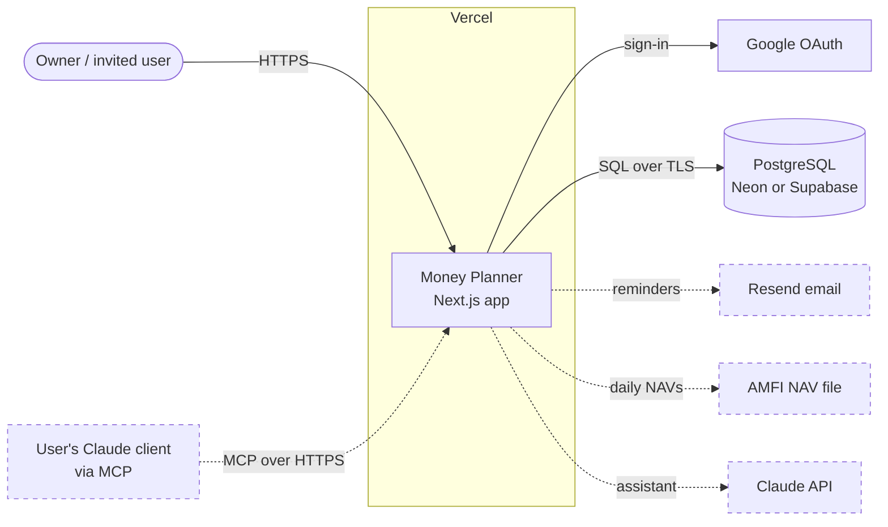
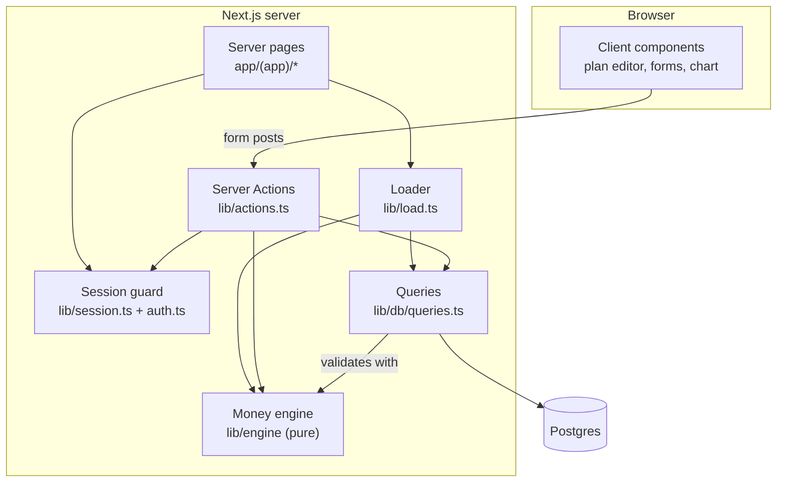
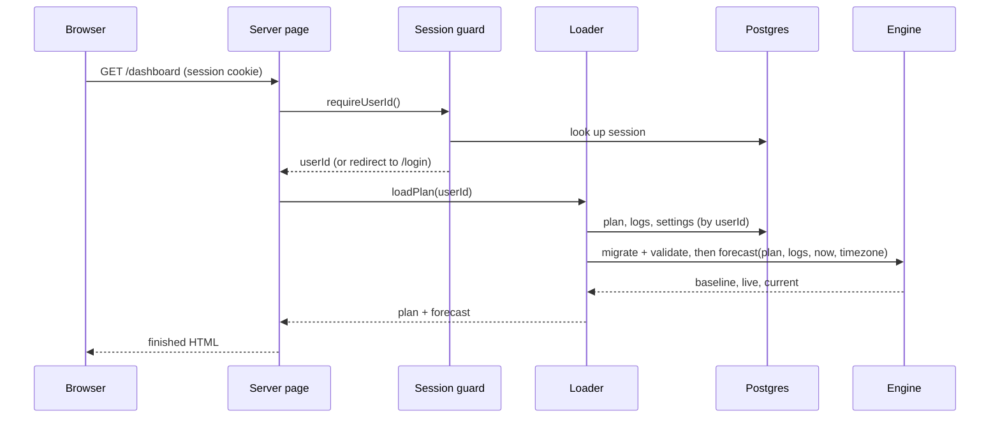
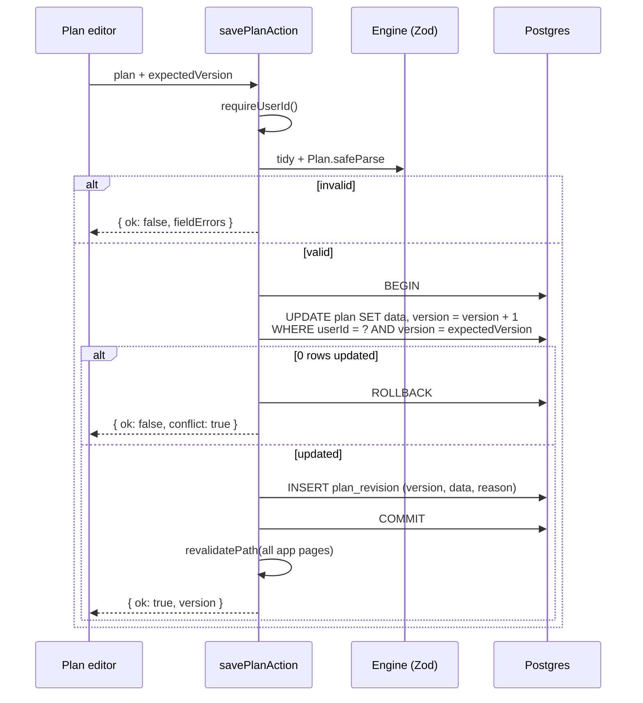

# System architecture

## 1. Context

Who and what the system talks to. Dashed boxes are Phase 2 and 3.



The browser talks only to the Next.js server. It never talks to the database or the engine directly.

## 2. Inside the app



### Layers and import rules

| Layer | Path | May import | Must not import |
| --- | --- | --- | --- |
| Engine | `lib/engine/` | `zod` only | React, Next.js, `lib/db`, anything with I/O |
| Data access | `lib/db/` | engine schemas and types, Drizzle | React, Next.js, actions |
| Server glue | `lib/session.ts`, `lib/load.ts`, `lib/actions.ts`, `auth.ts` | engine, db, Next.js server APIs | client components |
| Server pages | `app/**/page.tsx`, layouts | server glue, engine (formatting and pure helpers), components | `lib/db` directly (go through `load` or `queries`) |
| Client components | `components/*` with `"use client"` | engine types and formatting, actions | `lib/db`, `server-only` modules |

These rules are enforced in CI (`NFR-MNT-1`). The engine rule is the important one: it keeps all money logic testable without a database or a browser.

## 3. Request flows

### Viewing a page



Every app page renders on the server with fresh data on every request. There's no client-side data fetching and no cache of computed numbers, so no page can show a stale figure (principle 5).

### Saving the plan (target design)



The version check (`PLN-10`) and revision insert (`PLN-11`) are new in Phase 1.1. Today the save is a plain upsert.

## 4. Key design choices

Each choice has an ADR with the full reasoning.

| Choice | Why | ADR |
| --- | --- | --- |
| Server-rendered Next.js with Server Actions, no separate API | One deployable, no API layer to secure separately, data never cached in the browser | [0001](decisions/0001-nextjs-server-rendering-and-actions.md) |
| The plan is one versioned JSON document | It's always edited and calculated as a whole; migrations upgrade old versions | [0002](decisions/0002-plan-as-one-versioned-document.md) |
| A pure, deterministic engine | Testable, explainable, reusable by the AI assistant and MCP server | [0003](decisions/0003-pure-deterministic-engine.md) |
| Google sign-in, database sessions, allow-list | No passwords to store; sessions revocable; private by default | [0004](decisions/0004-google-auth-database-sessions.md) |
| Rupees as numbers, rounded only at display | Projections are estimates; precision without integer-paise complexity | [0005](decisions/0005-money-representation.md) |
| Scenarios as levers over the live plan | Scenarios stay comparable as the plan changes | [0006](decisions/0006-scenarios-as-levers.md) |
| Plan revisions and a frozen tracking baseline | "Behind plan" means behind the plan you committed to | [0007](decisions/0007-plan-revisions-and-frozen-baseline.md) |
| Carry shortfalls forward | An unaffordable plan must look unaffordable | [0008](decisions/0008-carry-shortfall-forward.md) |
| Current month in the user's timezone | Month-end in IST shouldn't depend on the server's UTC clock | [0009](decisions/0009-user-timezone-for-current-month.md) |
| Goals funded only by fixed investments are real goals | No hardcoded goal ids or labels | [0010](decisions/0010-no-orphan-goals.md) |

## 5. Rendering, caching and freshness

- App pages are dynamic: they read the session cookie, so Next.js never caches them statically.
- After every write, the action calls `revalidatePath` for every app page, so router-cached pages refetch.
- The engine runs on every request. A full projection costs under 5 ms, so caching results would add risk (staleness) for no gain.
- The client holds state only while editing (the plan editor's draft). It's discarded after a save.

## 6. Error handling

| Situation | Behaviour |
| --- | --- |
| Validation failure in an action | Returns `{ ok: false, fieldErrors, formError }`. The form shows each message next to its field and keeps the user's input |
| Save conflict | Returns `{ ok: false, conflict: true }`. The editor offers "Reload" and keeps the draft so nothing is lost |
| Not signed in | Redirect to `/login` |
| Plan document fails validation on read (corrupt or unknown version) | Error page saying the plan couldn't be read, with a link to export the raw data. The error is logged by id only. The plan is never auto-overwritten |
| Unexpected server error | The route's `error.tsx` boundary shows "Something went wrong" with a retry. The server log has a stack trace, no plan data |

## 7. Module layout

Phase 1.1 adds files rather than reorganising, to keep churn low:

```
lib/engine/
  schema.ts       Zod schemas and types (plan v2, log, levers)
  migrate.ts      NEW  schema migrations (v1 → v2), pure
  months.ts       month index helpers, raises(), timezone-aware currentMonth()
  project.ts      amounts over time + the monthly simulation + forecast
  house.ts        house outlook and EMI
  levers.ts       NEW  applyLevers(plan, levers) for scenarios
  display.ts      NEW  fund split rounding and other display helpers
  events.ts       Coming up
  summary.ts      scenario summary
  format.ts       ₹ formatting
  *.test.ts       tests next to the code
lib/db/
  schema.ts       Drizzle tables (adds plan.version, plan_revision, user_settings)
  queries.ts      every read and write, always filtered by userId
lib/
  actions.ts      Server Actions; split by feature if it grows past ~300 lines
  load.ts         loads plan, logs and settings, then runs the forecast
  session.ts      requireUserId()
```

## 8. Phase 2 and 3 extensions (outline)

These get their own design docs before their phase starts. The shape is fixed now so Phase 1.1 doesn't block them.

- **Scheduled jobs** (`AUT-1`–`AUT-3`): Vercel Cron calls `/api/cron/*` route handlers, protected by a `CRON_SECRET` header. A daily job downloads AMFI's NAV file into a shared `nav_price` table. A daily job sends due reminders through Resend.
- **Holdings** (`AUT-3`): a `holding` table of units per scheme, per bucket (EF, goal or fixed investment). The Track form pre-fills balance values as `units × latest NAV`. The engine is unchanged: it still receives balances.
- **AI assistant** (`AI-1`, `AI-2`): a streaming route handler calls the Claude API. Tools are thin wrappers over engine functions (`getPlan`, `forecast`, `runScenario`, `compare`). Writes go through the same Server Action validation, and only after the user confirms.
- **MCP server** (`AI-3`): an MCP endpoint in the same app, authenticated per user with revocable tokens, exposing the same read-only tools.
