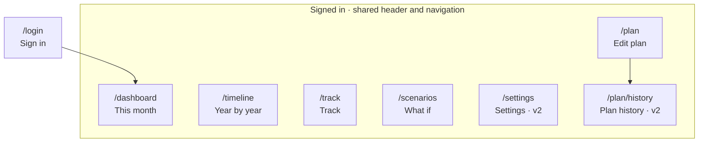

# Information architecture

## Site map

The navigation order follows how often each page is used: This month (every visit), Year by year, Track (monthly), What if (occasionally), Edit plan (occasionally). Settings and Plan history live behind the header menu and the editor, not in the main navigation.

`/` redirects to `/dashboard`, or to `/login` when signed out.

## Shared frame

- **Header:** app name, "Personal plan · amounts in ₹ per month", the signed-in email, and a menu with Settings, Export data and Sign out (**v2**: the menu replaces the plain Sign out button).
- **Navigation:** pill tabs, scrolling sideways on narrow screens. The current page is marked with `aria-current="page"`.
- **Not logged this month** banner (`DSH-9`) above the content on every page except Track.
- **No plan yet:** every page shows the same empty state, with "Start a blank plan" and "Load the example plan" (`SET-1`, `SET-2`).

## Pages

For each page: the question it answers, its content blocks top to bottom, and its states.

### Sign in (`/login`)

- **Answers:** how do I get in?
- **Blocks:** name and one-line pitch; "Continue with Google"; note that only allowed accounts can sign in.
- **States:** signed in → redirect to This month. Not on the allow-list → "This account isn't allowed. Ask the owner for access."

### This month (`/dashboard`)

- **Answers:** where does my money go right now?
- **Blocks:**
  1. **Summary strip:** in-hand · committed · free to allocate · status (`DSH-1`)
  2. **Where this month's money goes:** line items with per-fund SIP amounts; total equals in-hand (`DSH-2`); shortfall and one-time warnings at the top (`DSH-3`); carried shortfall (`DSH-8`)
  3. **Coming up:** the next 6 events (`DSH-4`)
  4. **Salary changed?:** month, amount, note (`DSH-5`)
  5. **Goals:** emergency fund card, then one card per goal in plan order, house card with verdict (`DSH-6`)
  6. **How your money grows:** chart (`DSH-7`)
- **States:** normal · building emergency fund · investing for goals · short this month · carrying a shortfall · plan ended (current month past the horizon: suggests extending the plan).

### Year by year (`/timeline`)

- **Answers:** what does the next decade look like?
- **Blocks:** table (`TML-1`) with expandable years (`TML-2`); assumptions line; Download CSV (`TML-3`).
- **States:** a current-month row highlighted; years with a shortfall marked.

### Track (`/track`)

- **Answers:** am I really on plan?
- **Blocks:**
  1. **Log balances:** month picker defaulting to this month (`TRK-2`); fields pre-filled with expected values (`TRK-1`); salary-difference prompt after saving (`TRK-5`)
  2. **How tracking works:** four short steps
  3. **History:** each log against the frozen baseline, green or red (`TRK-3`); delete with confirmation (`TRK-6`); "Baseline: plan as of {date} · Change" control
- **States:** no logs yet · this month logged (form switches to "Update") · baseline is the current plan.

### What if (`/scenarios`)

- **Answers:** what if I switch jobs or buy a bigger house?
- **Blocks:**
  1. **Try a what-if:** name and lever fields; empty means unchanged (`WIF-1`)
  2. **Side by side:** your plan plus each scenario in columns, better or worse cells tinted (`WIF-2`); each column has Edit, Apply to plan and Remove (`WIF-4`, `WIF-5`)
- **States:** no scenarios · a lever no longer applies (shown on that column).

### Edit plan (`/plan`)

- **Answers:** how do I change my plan?
- **Blocks:** sticky save bar (status, Discard, Save); then sections: Income · Expenses and EMIs · Fixed investments · One-time payments · Goals (emergency fund first) · Assumptions. A "History" link to revisions.
- **States:** all saved · unsaved changes (leave-page warning, `PLN-9`) · saving · saved · field errors (inline, plus a summary at the top linking to each, `PLN-8`) · conflict (`PLN-10`) · warnings (shares not 100%).

### Plan history (`/plan/history`) v2

- **Answers:** what did my plan look like before?
- **Blocks:** list of revisions (date, reason); view a revision read-only; Restore; "Use as tracking baseline".

### Settings (`/settings`) v2

- **Answers:** how is my account set up?
- **Blocks:** timezone (`ACC-6`); Phase 2: salary day and email reminders; Export my data (`ACC-4`); Delete my account (`ACC-5`), in a danger zone that requires typing "delete".

## Cross-page links

| From | Link | To |
| --- | --- | --- |
| Not-logged banner | "Log this month" | Track |
| Shortfall warning | "Review expenses" | Edit plan, Expenses section |
| Unallocated money | "Assign to a goal" | Edit plan, Goals section |
| Coming up: salary change | event | Edit plan, Income section |
| Track: salary differs | "Record salary change" | Dialog on Track (no navigation) |
| What if: Apply to plan | confirm | Edit plan, with a "Scenario applied" message |
