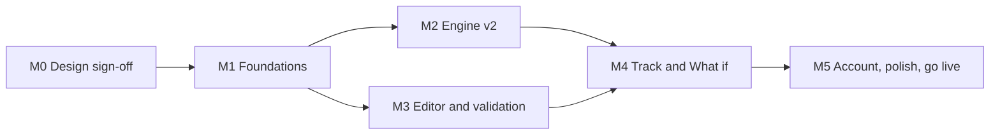

# Roadmap

## Where we are

Phase 1 (core app) is built and works. Reviewing it against these docs found [28 gaps](current-state-and-gaps.md), including four high-severity correctness problems (G-02, G-03, G-04, G-05). So the next phase isn't new features: it's **Phase 1.1, hardening**, so the numbers can be trusted before anything is automated or AI is added on top.

## Sequencing principles

1. **Lock behaviour before changing it.** Golden and property tests on the v1 engine come first, so every v2 change shows exactly which numbers moved and why.
2. **Version data before reshaping it.** `schemaVersion` and migrations come before any plan field changes shape.
3. **Backend before UI.** Revisions exist before the history page; levers exist before the scenario editor.
4. **Each milestone ships.** Every milestone ends deployed to production and usable, not half-done.

## Phase 1.1: Hardening

### M0: Design sign-off

- Owner reviews these docs and answers the [open questions](open-questions.md).
- `Proposed` ADRs become `Accepted`, or are changed.
- **Exit:** no blocking open question left.

### M1: Foundations (no visible behaviour change)

| Work | Requirements / gaps |
| --- | --- |
| GitHub Actions CI: typecheck, ESLint, import-boundary check, tests, build; protect `main` | NFR-MNT-1, NFR-MNT-3, G-06 |
| Golden tests from the worked examples; property tests for the invariants (against v1) | NFR-COR-2, ENG-6, ENG-10 |
| Allow-list fails closed in production | ACC-2, G-01 |
| Security headers and CSP | NFR-SEC-5, G-25 |
| `schemaVersion` + `migrate.ts` (v1 → v2 creates real goals for orphan ids, sets defaults) | ENG-7, ENG-9 (data part), G-05 |
| `plan.version`, `plan_revision`, optimistic save in a transaction | PLN-10, PLN-11 (backend), G-07, G-08 |
| `user_settings` with timezone; `currentMonth(now, tz)` | ACC-6 (backend), ENG-8, G-09 |
| PGlite data-access tests; action authentication test | NFR-SEC-1, NFR-SEC-2 |
| Zero-setup local run: embedded Postgres (PGlite) and dev-only sign-in | EXP-8, ADR-0011 |

**Exit:** CI green on `main`; production migrated; every existing page shows the same numbers as before.

### M2: Engine v2

| Work | Requirements / gaps |
| --- | --- |
| Carry shortfall forward; repay first; `shortfall` on logs | ENG-2, G-03 |
| Step-ups and inflation from the item's own start | ENG-3, G-10 |
| Emergency fund target in months of expenses | ENG-5, G-13 |
| Goal completion: hold or withdraw; house purchase starts the EMI and ends the replaced expense | ENG-4, G-11 |
| `applyLevers` for scenarios | WIF-3 (engine) |
| Fund split rounding with the remainder on the largest fund | DSH-2, G-23 |
| Update the engine spec v1 notes and the worked examples; golden tests updated with explanations | ENG-10 |

**Exit:** all engine tests green; worked examples updated; the spec has no v1/v2 differences left except where noted as intentional.

### M3: Editor and validation

| Work | Requirements / gaps |
| --- | --- |
| `ActionResult` with field errors; inline errors and an error summary; warnings for shares and splits | PLN-8, G-15 |
| Expense and fixed investment start months; multiple step changes; goal return override; protected flag; `onTarget`; `replacesExpenseId`; EF mode | PLN-3, PLN-4, PLN-6, PLN-7, G-14 |
| Drop half-filled one-time rows; stable row keys; leave-page warning | PLN-5, PLN-9, G-16, G-17, G-18 |
| Conflict message on a stale save | PLN-10 (UI) |
| Plan history page: list, view, restore | PLN-11 (UI) |
| Design system refresh: responsive shell (top nav / bottom tabs), header menu, theme toggle, toasts, number transitions | EXP-5, EXP-6, EXP-7 |
| Live impact panel in the editor (engine in the browser) | EXP-3, ADR-0012 |

**Exit:** every plan field in the plan model is editable; no save loses input.

### M4: Track and What if

| Work | Requirements / gaps |
| --- | --- |
| History against the frozen baseline; "Use current plan as baseline" | TRK-3, G-02 |
| Log any month (backfill); salary-difference prompt | TRK-2, TRK-5, G-19, G-20 |
| Scenarios as levers; one-off conversion script; edit and rename; apply to plan | WIF-3, WIF-4, WIF-5, G-04 |
| This month: carried shortfall, not-logged banner, generated warnings, uniform goal cards, Coming up amounts | DSH-3, DSH-4, DSH-6, DSH-8, DSH-9, G-12, G-21, G-22 |
| What-if sandbox with live sliders, then save as scenario | EXP-2 |

**Exit:** journeys J2, J3 and J4 pass end to end.

### M5: Account, polish, go live

| Work | Requirements / gaps |
| --- | --- |
| Settings page: timezone, export my data, delete my account | ACC-4, ACC-5, ACC-6, G-24 |
| "Load the example plan" button in the empty state | SET-2, G-26 |
| Public landing page with an interactive demo on the sample plan | EXP-1 |
| Interactive charts: series toggles and a table view | EXP-4 |
| Playwright e2e suite in CI; axe accessibility checks | NFR-UX-1, testing strategy |
| Accessibility and mobile pass; chart text alternative | NFR-UX-1, NFR-UX-2 |
| Production deploy; owner enters the real plan in the app (never in the repo) and logs the first month | J1, J2 |

**Phase 1.1 exit:**

- Every `Must` and `Should` in sections 1–9 of the [functional requirements](../02-requirements/functional-requirements.md) is `Built`.
- Every High and Medium gap is closed.
- Two consecutive months logged in production.

## Phase 2: Automation

A design doc (`docs/09-phase-2/`) is written and agreed before work starts. Planned order:

1. **Reminders** (AUT-1, AUT-2): Vercel Cron plus Resend; salary day and the raise month.
2. **Holdings and NAV** (AUT-3): units per scheme; daily AMFI NAV import; Track pre-filled from units × NAV. Policies and PPF stay manual (they have no AMFI NAV).
3. **CAS import** (AUT-4): parse units from a CAMS/KFintech PDF in memory.
4. **PWA** (AUT-5).

**Exit:** a month's log takes under a minute, mostly confirming pre-filled values.

## Phase 3: AI assistant

Again, a design doc comes first. It covers tool definitions over engine functions, the confirmation flow for writes, rate limits and the privacy notice.

1. **Assistant** (AI-1, AI-2): chat on top of the engine tools.
2. **MCP server** (AI-3): read-only tools for the owner's Claude client.

**Exit:** the assistant answers the five reference questions (to be written in the Phase 3 design) with numbers that match the engine exactly.
